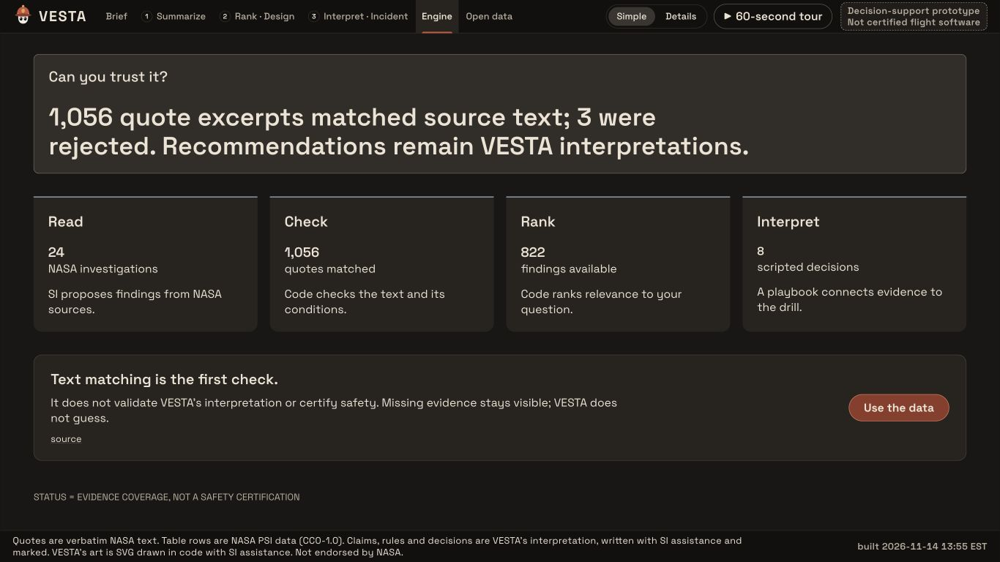
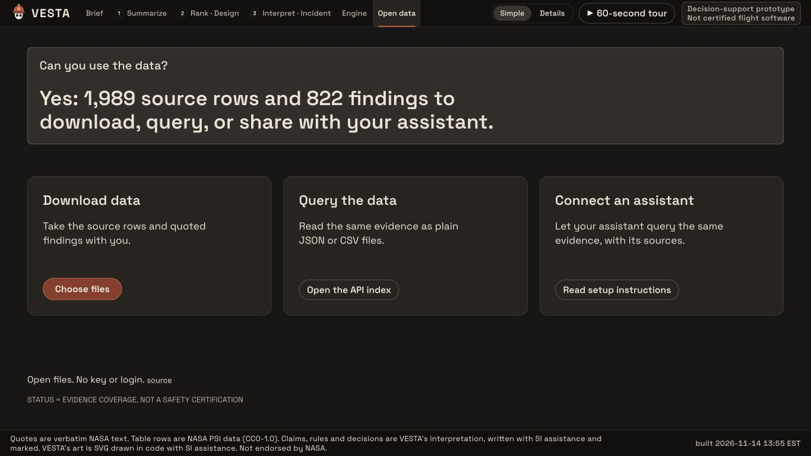
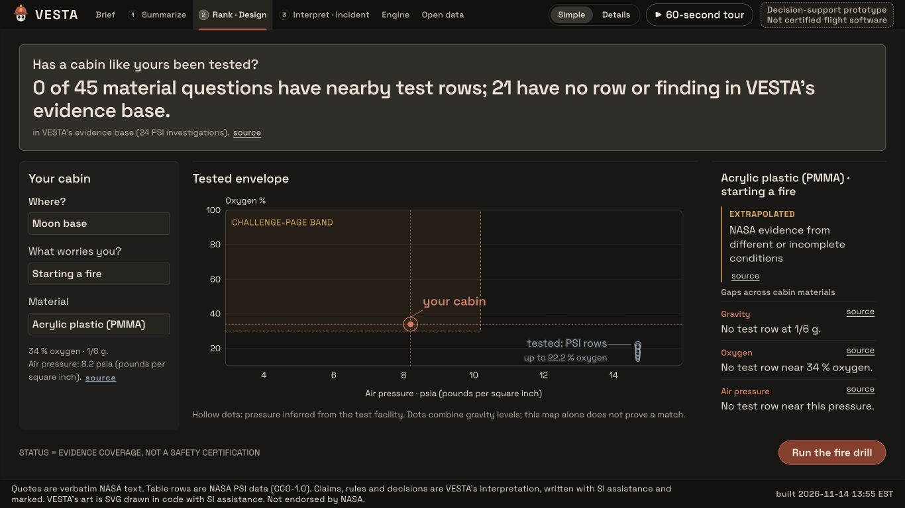

# VESTA

NASA combustion evidence, turned into traceable questions about spacecraft fire safety. Built by **Team Zerack** for NASA Space Apps Challenge 2026, “Flame in Freefall”.

[Dashboard](https://itzjk.github.io/vesta/) · [Repository](https://github.com/itzjk/vesta) · [API](docs/API.md) · [MCP](mcp/README.md)

VESTA summarizes PSI investigations, ranks verified findings for a cabin atmosphere, and interprets a scripted fire drill. Every finding opens its NASA quote; every test row keeps its PSI investigation, table and row reference. Engine shows the counts and the rejected candidates from the actual build.

PROVEN means tested at these conditions. EXTRAPOLATED means evidence exists but a condition or evidence type differs. NEVER TESTED describes a question with no matching evidence in VESTA's evidence base. Status is evidence coverage, not a safety certification.

The Incident screen is simulated telemetry, scripted, not a physics model. Its thresholds are scenario parameters, not NASA limits. A missing source leads to a published ISS protocol with an explicit applicability limit, or hands the decision to the crew.

## See it in three screens







Screenshots captured from the running app at 1920×1080. Simple is the default; the **Simple | Details** switch reveals the full technical view. On a phone, Simple becomes a readable single column.

## Check a citation

Open [this ventilation finding](https://itzjk.github.io/vesta/#/design?src=S-VENT-01). A **source** link opens the same drawer from any claim. Read the exact quote inside its surrounding sentence, check the source level and conditions, then follow the NASA link. **Quote verified** means the excerpt matched the cached source text; it does not certify VESTA's interpretation. For a table claim, the drawer shows the PSI investigation, original table, row number and raw cells, including any inferred value.

## Connect an assistant

Use Node 24 from a repository clone. Configure a stdio MCP client to run this local command:

```sh
node mcp/server.mjs
```

It reads the committed evidence without a network connection. To query the published data with the same local server:

```sh
node mcp/server.mjs --base https://itzjk.github.io/vesta/
```

The four tools are `search_evidence`, `rank_evidence`, `check_design` and `get_finding`. [Client configuration and a recorded exchange](mcp/README.md) include a complete example. A website URL alone cannot launch a stdio server.

## Run and reproduce

The deployed artifact is `web/`: static HTML, CSS, ES modules and committed JSON/CSV files. Serve that directory with any static HTTP host; hash routes and relative asset URLs also work under `/vesta/`. No packages or bundler are required. GitHub Pages publishes `web/` through `.github/workflows/pages.yml` after the release gate.

Use Node 24 and Python 3.9 or newer for a source build:

```sh
node tools/build.mjs
node tools/ntrs-feed.mjs --offline
node mcp/record.mjs
node --test "tests/**/*.test.mjs"
node tools/check.mjs
```

Rebuilding evidence requires the delivered `data/`, reviewed `research/evidence/`, and cached NASA text under `research/raw/`. The challenge page cache is deliberately not redistributed. A public clone can use the committed `web/data/` and `web/api/v1/` without rebuilding. Missing research inputs cannot be recreated by inventing records.

The source build checks quotes, sentence context, table cells, conditions and references before writing outputs. The same pure modules in `web/js/core/` compute browser, API and MCP scores and coverage. SI assistants propose claims and rules at build time; deterministic code checks and executes them. Nothing is generated at runtime.

With the private browser harness available, `VESTA_NS=wp7 ./tests/shots.sh` runs the full route and interaction list at 1920×1080 and the six routes at 1366×768, plus Simple captures at 390×844 on the browser machine. Without that harness, the script exits with an explicit message. Captures require visual inspection in addition to automatic checks.

## Open interfaces

- [Static API manifest](https://itzjk.github.io/vesta/api/v1/index.json), [tests CSV](https://itzjk.github.io/vesta/api/v1/tests.csv), [findings CSV](https://itzjk.github.io/vesta/api/v1/findings.csv).
- [API contracts and score](docs/API.md), [four-tool stdio MCP server](mcp/README.md), [telemetry format](docs/TELEMETRY.md).
- NTRS snapshot: `web/feed/ntrs.json`. `node tools/ntrs-feed.mjs` requests newest citations and falls back to the cached index without network. `--offline` uses only that index. Feed items do not become verified evidence automatically. Scheduled refresh is disabled; manual refresh is available.
- Routes: `#/brief`, `#/investigations`, `#/design`, `#/incident`, `#/engine`, `#/open`. `#/open?view=details&feed=off` demonstrates the feed-unavailable state.

## SI use and limits

Code and authored documentation: MIT, copyright 2026 Team Zerack. NASA PSI tables: CC0-1.0, with row-level provenance retained. NASA text is quoted with source attribution and is not relicensed as MIT. Fonts retain their own license. See [LICENSE](LICENSE).

SI agents assisted source extraction, proposed claims and rules, and helped author code and SVG artwork. Deterministic gates verify quote matching, sentence context, table cells and reported conditions. Statuses, relevance scores and the scripted officer use deterministic code, with no runtime model or generated advice. These checks do not establish independent scientific approval of every interpretation. Claims and recommendations remain labelled VESTA interpretations.

Evidence coverage concerns a material and a concern in VESTA’s evidence base (24 PSI investigations), never the safety of a whole cabin. Source rows include days, series and measurement sessions; they cannot be summed as independent burns. NTRS records are a dated snapshot, not automatically admitted evidence. The ISS fallback was written for low Earth orbit with ground support and a return vehicle; it is not validated for the drill’s exploration vehicle. VESTA is a decision-support prototype, not certified flight software, and is not endorsed by NASA. No NASA logos or insignia are used.
